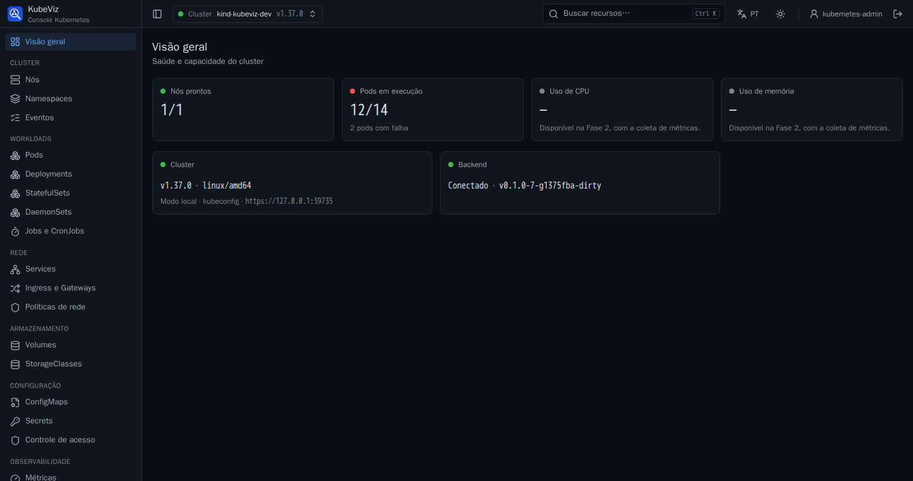
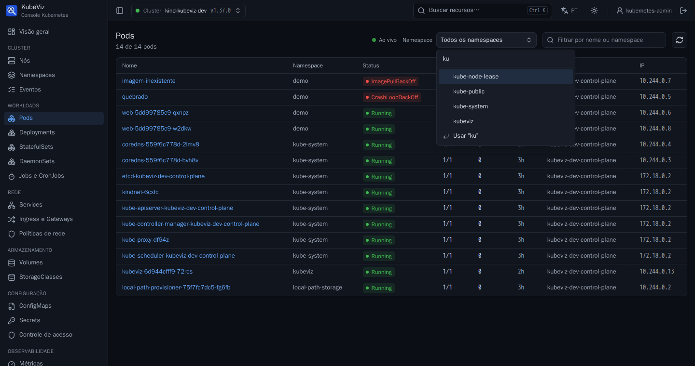

# KubeViz

Interface web open source para gestão de clusters Kubernetes, com painéis de
performance e uptime e assistentes (wizards) para configurar o ambiente.

> **Status:** `v0.3.0`. Lista e edita qualquer recurso do cluster (inclusive
> CRDs) em tempo real, com YAML, logs, terminal, ações, eventos, busca global
> (Ctrl+K) e login corporativo (OIDC), respeitando o RBAC de cada usuário e
> aguentando milhares de pods. Rodando como binário, as contas entram com
> senha ou com Google, Microsoft, GitHub e OIDC configurados pela interface. Painéis de
> performance e uptime vêm na Fase 2: veja o [roadmap](docs/05-roadmap.md) e o
> [progresso](docs/PROGRESSO.md).





## Instalação no cluster (Helm)

```bash
helm install kubeviz oci://ghcr.io/fbicudo/charts/kubeviz --version 0.3.0 -n kubeviz --create-namespace
kubectl -n kubeviz port-forward svc/kubeviz 8443:443
```

Abra https://localhost:8443 e entre com um token do Kubernetes
(`kubectl create token <serviceaccount> -n <namespace>`). O KubeViz usa o token
da própria pessoa em cada requisição, então cada usuário vê apenas o que o RBAC
permite; a ServiceAccount do KubeViz não tem permissão nenhuma. Sem
`tls.secretName`, o chart gera um certificado autoassinado, adequado só para
testes. Opções em [values.yaml](deploy/helm/kubeviz/values.yaml).

Para login corporativo (Keycloak, Dex, Entra ID, Okta…), veja
[Login corporativo (OIDC)](docs/oidc.md). Rodando como binário ou container, o
primeiro acesso cria a conta de administrador pela própria tela, e os usuários
podem entrar com passkey (digital, rosto ou PIN, sem senha) ou com Google,
Microsoft, GitHub ou OIDC configurados pela interface:
[Contas, passkeys e provedores de login](docs/login-provedores.md).

## Desenvolvimento

Requisitos: Go 1.27+, Node.js LTS, pnpm. Detalhes em [CONTRIBUTING.md](CONTRIBUTING.md).

```bash
make deps           # dependências
make dev-backend    # API em http://127.0.0.1:4466
make dev-frontend   # UI em http://localhost:5173
make build          # binário único em bin/kubeviz
make test-envtest   # testes de RBAC contra um API server real (sem Docker)
```

Executando:

```bash
./bin/kubeviz                              # usa o kubeconfig e o contexto atuais
./bin/kubeviz --context prod --log-level debug
./bin/kubeviz --kubeconfig ~/outro.yaml
./bin/kubeviz --listen 0.0.0.0:4466 --tls-cert-file tls.crt --tls-key-file tls.key   # acesso pela rede
```

Para entrar com usuário e senha, crie uma conta (a senha é pedida sem
aparecer na tela; vale na hora, sem reiniciar):

```bash
./bin/kubeviz user add <nome>
```

Sem contas, o KubeViz imprime no terminal um link com um token de acesso gerado
a cada execução (`http://127.0.0.1:4466/auth/local?token=...`). Nos dois casos,
só quem tem a senha ou o link entra, o que impede outras pessoas de usar o seu
kubeconfig.

Imagem: `ghcr.io/fbicudo/kubeviz` (amd64 e arm64). Licença: [Apache-2.0](LICENSE).

## Documentação

| # | Documento | Conteúdo |
|---|-----------|----------|
| 1 | [Visão e escopo](docs/01-visao-e-escopo.md) | Objetivo, público-alvo, escopo do MVP e o que fica de fora |
| 2 | [Análise de viabilidade](docs/02-viabilidade.md) | Mercado e concorrentes, viabilidade técnica, riscos, esforço |
| 3 | [Arquitetura e plataforma](docs/03-arquitetura.md) | Stack recomendada, componentes, decisões (ADRs) |
| 4 | [Requisitos](docs/04-requisitos.md) | Requisitos funcionais e não funcionais |
| 5 | [Roadmap](docs/05-roadmap.md) | Fases, entregas e critérios de pronto |
| 6 | [Decisões e perguntas em aberto](docs/06-perguntas-em-aberto.md) | Decisões de produto já tomadas e o que ainda falta decidir |
| — | [Login corporativo (OIDC)](docs/oidc.md) | Configuração, modos impersonate e token, solução de problemas |
| — | [Contas e provedores de login](docs/login-provedores.md) | Primeiro acesso, usuários, Google, Microsoft, GitHub e OIDC no modo local |
| — | [Desempenho](docs/desempenho.md) | Como medir com milhares de pods (kwok) e os resultados |

## Resumo executivo

- **Viável?** Sim, tecnicamente. A API do Kubernetes é aberta, estável e bem
  documentada, e todas as peças (watch em tempo real, métricas, dry-run,
  server-side apply) existem. O risco principal **não é técnico, é de
  posicionamento**: o Kubernetes Dashboard oficial foi arquivado em jan/2026 e o
  Kubernetes SIG UI recomenda o **Headlamp** (Apache-2.0, ativo) como sucessor. Um
  projeto novo precisa de um diferencial claro; a proposta deste documento é que esse
  diferencial seja **observabilidade de performance/uptime nativa + assistentes
  guiados de configuração**, áreas em que as ferramentas existentes são fracas ou
  dependem de plugins.
- **Plataforma recomendada:** backend em **Go** (linguagem nativa do Kubernetes,
  `client-go`, informers, binário único, baixo consumo de memória) + frontend em
  **TypeScript/React**. Ambos empacotados em **um único binário/imagem de
  container**, instalável com um comando via **Helm**.
- **Licença:** **Apache-2.0** (padrão do ecossistema CNCF, inclui concessão de
  patentes).
- **Decisões já tomadas:** nome **KubeViz**; projeto de comunidade open source; produto próprio (não
  plugin do Headlamp); um cluster por instalação no MVP; métricas via Prometheus
  com coletor embutido; uptime por estado do Kubernetes + sondas; oito assistentes;
  login OIDC; visual de painel de observabilidade; pt-BR e inglês. Lista completa
  em [decisões e perguntas em aberto](docs/06-perguntas-em-aberto.md).
- **Esforço estimado do MVP:** ~29 a 37 semanas de trabalho para um
  desenvolvedor com assistência do Claude (≈ 7 a 9 meses em tempo integral). A
  dedicação é variável, então o prazo no calendário acompanha o ritmo real
  (detalhado em [viabilidade](docs/02-viabilidade.md#25-estimativa-de-esforço)).
