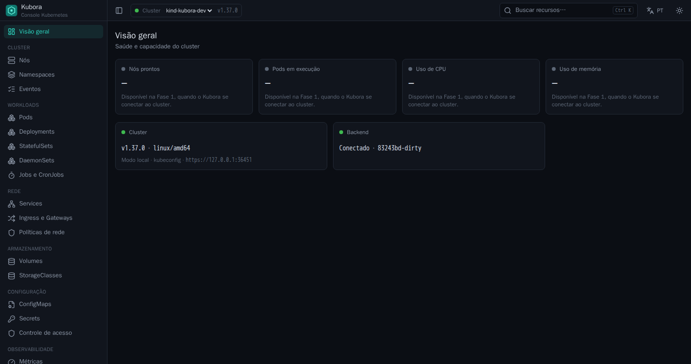

# Kubora

Interface web open source para gestão de clusters Kubernetes, com painéis de
performance e uptime e assistentes (wizards) para configurar o ambiente.

> **Status:** Fase 0 (fundação) em andamento. Conecta ao cluster, troca de
> contexto, autentica usuários e repassa chamadas à API com as credenciais de
> cada um; ainda não lista recursos. Acompanhe em [docs/PROGRESSO.md](docs/PROGRESSO.md).



## Desenvolvimento

Requisitos: Go 1.27+, Node.js LTS, pnpm. Detalhes em [CONTRIBUTING.md](CONTRIBUTING.md).

```bash
make deps           # dependências
make dev-backend    # API em http://127.0.0.1:4466
make dev-frontend   # UI em http://localhost:5173
make build          # binário único em bin/kubora
make test-envtest   # testes de RBAC contra um API server real (sem Docker)
```

Executando:

```bash
./bin/kubora                              # usa o kubeconfig e o contexto atuais
./bin/kubora --context prod --log-level debug
./bin/kubora --kubeconfig ~/outro.yaml
```

O Kubora imprime no terminal um link com um token de acesso gerado a cada
execução (`http://127.0.0.1:4466/auth/local?token=...`). Só quem tem o link
entra, o que impede outras pessoas na mesma máquina de usar o seu kubeconfig.

Licença: [Apache-2.0](LICENSE).

## Documentação

| # | Documento | Conteúdo |
|---|-----------|----------|
| 1 | [Visão e escopo](docs/01-visao-e-escopo.md) | Objetivo, público-alvo, escopo do MVP e o que fica de fora |
| 2 | [Análise de viabilidade](docs/02-viabilidade.md) | Mercado e concorrentes, viabilidade técnica, riscos, esforço |
| 3 | [Arquitetura e plataforma](docs/03-arquitetura.md) | Stack recomendada, componentes, decisões (ADRs) |
| 4 | [Requisitos](docs/04-requisitos.md) | Requisitos funcionais e não funcionais |
| 5 | [Roadmap](docs/05-roadmap.md) | Fases, entregas e critérios de pronto |
| 6 | [Decisões e perguntas em aberto](docs/06-perguntas-em-aberto.md) | Decisões de produto já tomadas e o que ainda falta decidir |

## Resumo executivo

- **Viável?** Sim, tecnicamente. A API do Kubernetes é aberta, estável e bem
  documentada, e todas as peças (watch em tempo real, métricas, dry-run,
  server-side apply) existem. O risco principal **não é técnico, é de
  posicionamento**: o Kubernetes Dashboard oficial foi arquivado em jan/2026 e o
  Kubernetes SIG UI recomenda o **Headlamp** (Apache-2.0, ativo) como sucessor. Um
  projeto novo precisa de um diferencial claro; a proposta deste documento é que esse
  diferencial seja **observabilidade de performance/uptime nativa + assistentes
  guiados de configuração**, áreas em que as ferramentas existentes são fracas ou
  dependem de plugins.
- **Plataforma recomendada:** backend em **Go** (linguagem nativa do Kubernetes,
  `client-go`, informers, binário único, baixo consumo de memória) + frontend em
  **TypeScript/React**. Ambos empacotados em **um único binário/imagem de
  container**, instalável com um comando via **Helm**.
- **Licença:** **Apache-2.0** (padrão do ecossistema CNCF, inclui concessão de
  patentes).
- **Decisões já tomadas:** nome **Kubora**; projeto de comunidade open source; produto próprio (não
  plugin do Headlamp); um cluster por instalação no MVP; métricas via Prometheus
  com coletor embutido; uptime por estado do Kubernetes + sondas; oito assistentes;
  login OIDC; visual de painel de observabilidade; pt-BR e inglês. Lista completa
  em [decisões e perguntas em aberto](docs/06-perguntas-em-aberto.md).
- **Esforço estimado do MVP:** ~29 a 37 semanas de trabalho para um
  desenvolvedor com assistência do Claude (≈ 7 a 9 meses em tempo integral). A
  dedicação é variável, então o prazo no calendário acompanha o ritmo real
  (detalhado em [viabilidade](docs/02-viabilidade.md#25-estimativa-de-esforço)).
