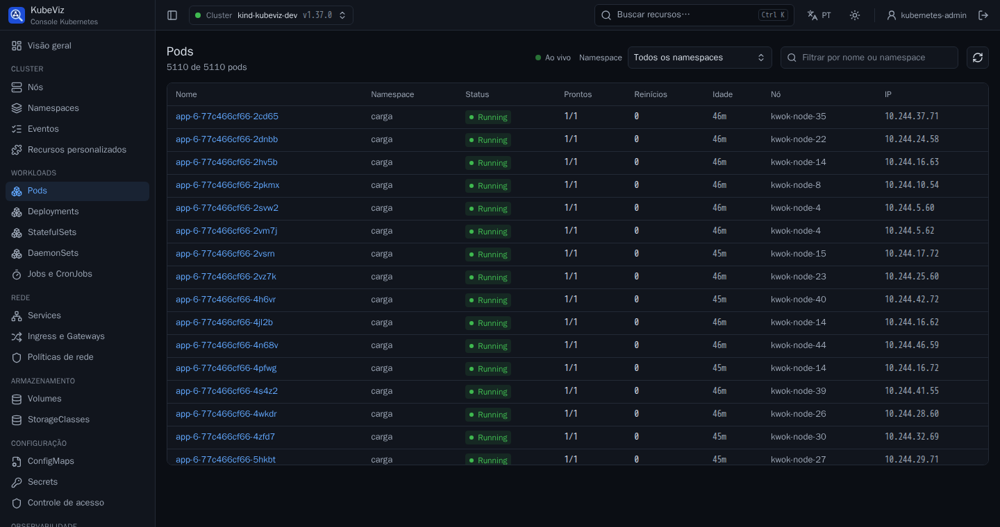

# Desempenho com muitos objetos

Metas ([requisitos](04-requisitos.md)):

- **RNF-04:** primeira renderização em menos de 2 s; navegação com cache em
  menos de 300 ms.
- **RNF-05:** listas de 5.000 itens filtráveis em menos de 1 s.
- **RNF-06:** backend com menos de 256 MB de memória num cluster de cerca de
  5.000 pods.

## Como medir

```bash
make scale-up                # 5.000 pods simulados pelo kwok no kind (PODS=10000 para mais)
./bin/kubeviz --kubeconfig ~/.kube/kubeviz-demo.yaml   # anote o token do link
cd frontend && KUBEVIZ_LOCAL_URL=http://127.0.0.1:4466 KUBEVIZ_LOCAL_TOKEN=<token> pnpm perf
make scale-down
```

O [roteiro](../frontend/scripts/perf.mjs) usa o Chromium (Playwright). Ele mede
cada cenário do início até a tela mostrar o resultado e registra os
**travamentos**: tarefas de mais de 50 ms na thread principal, durante as
quais a página não responde.

Os cenários:

- primeira carga;
- navegação com cache;
- filtro;
- rolagem;
- 500 pods excluídos e recriados (rajada do watch);
- busca global;
- página de eventos.

## O que foi feito (tarefa 1.10)

- **Virtualização:** a partir de 200 linhas, as tabelas desenham só as linhas
  visíveis e uma margem. Com 5.110 pods, a página tem cerca de 60 linhas no
  DOM.
  - A tabela ganha rolagem própria com o cabeçalho fixo.
  - Leitores de tela recebem o total em `aria-rowcount`.
  - O filtro vale para todas as linhas.
- **Watch em lote:**
  - os eventos que chegam em até 100 ms são aplicados juntos, com um índice
    por objeto: o custo é proporcional a linhas + eventos, não a linhas ×
    eventos;
  - cada lote gera uma só atualização da tela;
  - as listas não usam o compartilhamento estrutural do TanStack Query, que
    comparava em profundidade todos os objetos a cada atualização.
- **Listas mais leves:** as listas de pods, as tabelas e os eventos descartam
  os `managedFields`, cerca de 3/4 do tamanho de um pod. O detalhe continua
  buscando o objeto completo.
- **Busca global:** reaproveita a lista de pods já em cache, em vez de baixar
  de novo os metadados de milhares de pods.
- **Ordenação:** usa `Intl.Collator` (bem mais rápido que `localeCompare`) e a
  ordem natural (app-2 antes de app-10).

## Resultados (5.110 pods, 2/11/2026)

Máquina de desenvolvimento modesta, com o cluster kind na mesma máquina:

- 4 núcleos e 3,3 GB de memória;
- o API server sozinho usa 1,2 GB, e o sistema estava usando swap (carga de 5
  a 12).

Por isso os tempos variam muito entre rodadas. A tabela mostra o intervalo das
três rodadas finais.

| Cenário | Antes | Depois | Meta |
|---|---|---|---|
| Lista de pods, do clique até completa | 12,7 s (travou 8,7 s) | com cache: 0,15 e 0,20 s (2,6 s na rodada com swap pesado); a frio: 2,5–8,6 s | < 300 ms com cache / < 2 s |
| Filtrar 5.110 pods | 0,86 s | 0,07–0,88 s | < 1 s ✔ |
| Limpar o filtro | 3,6 s (travou 2,2 s) | 0,06–0,53 s | < 1 s ✔ |
| 500 pods excluídos pelo watch | **página travada por mais de 10 min** | a lista acompanha o cluster; travamento máximo de 0,34–1,7 s | — |
| 500 pods criados pelo watch | (não chegou a rodar) | travamento máximo de 0,3–0,8 s | — |
| Busca global (Ctrl+K) | — | 0,66–0,79 s (reaproveitando o cache) | — |
| Página de eventos (~9.000 eventos) | — | 2,4–3,7 s, dos quais ~1,7 s são do API server | — |
| Memória do backend (RSS máximo) | — | 19–26 MB | < 256 MB ✔ |
| Memória JS do navegador | — | 65–104 MB | — |

**Primeira carga, com o tempo do navegador isolado:**

- **Método:** as respostas da API (a lista real de 5.110 pods, 19,8 MB) foram
  servidas da memória, com o cluster pausado.
- **Resultado:** o KubeViz levou de 0,87 a 1,2 s para abrir /pods do zero
  (aplicação, interpretação da lista e desenho), com travamento máximo de
  ~130 ms.
- **Composição:** o restante da primeira carga é o API server montando a
  lista: ~0,9 s nesta máquina, já com compressão (2,3 MB na rede).
- **Meta de 2 s:** depende da latência do API server do cluster; nesta máquina
  sobrecarregada, ainda não foi confirmada.



## Pendente

- **Teste com 10 mil pods:** previsto na arquitetura. Não coube nesta máquina:
  o kind passaria de 2,5 GB numa máquina de 3,3 GB. Precisa de uma máquina
  maior (`make scale-up PODS=10000`).
- **Confirmar a meta de primeira carga (< 2 s):** precisa de uma máquina sem
  swap, ou de um cluster real.
- **Reduzir o download:** o API server não permite omitir os `managedFields`
  nas listas. Retirá-los no backend exigiria decodificar e recodificar respostas
  de dezenas de MB, à custa da memória do backend. Fica para avaliar se a
  primeira carga não atingir a meta em clusters reais.
