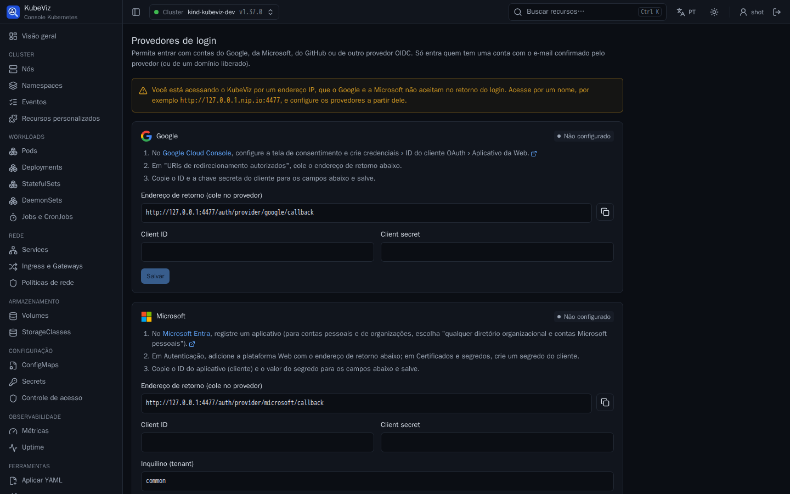
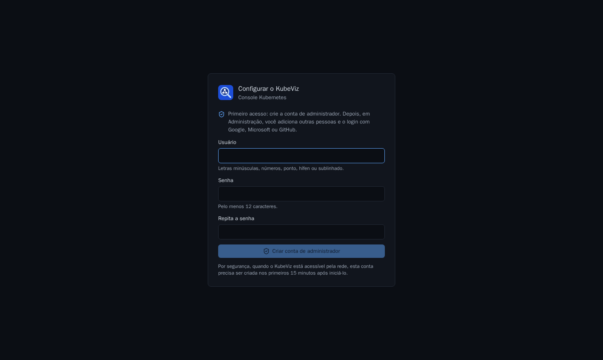
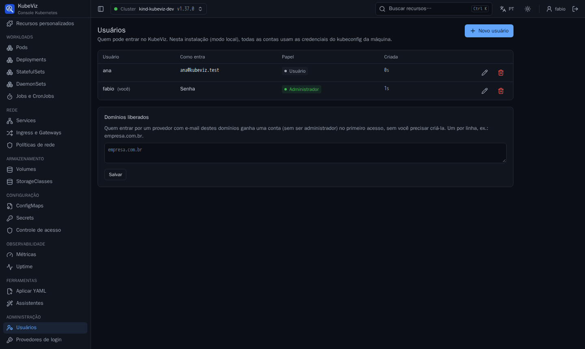
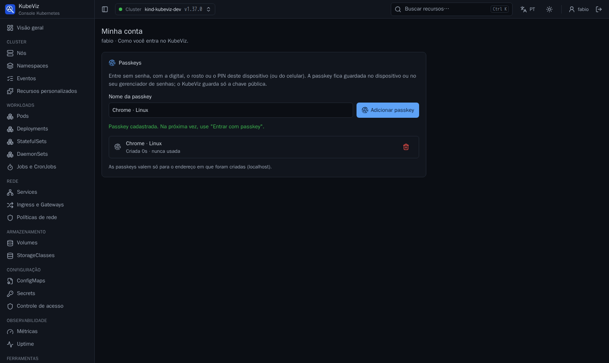

# Contas, passkeys e login com Google, Microsoft, GitHub ou OIDC (modo local)

Este guia vale para o KubeViz rodando como binário ou container (modo local),
em que ele usa o kubeconfig da máquina. Num cluster (instalação por Helm), o
login corporativo é o OIDC descrito em [oidc.md](oidc.md), com as permissões
do RBAC de cada usuário.



## Primeiro acesso

Sem nenhuma conta, a tela de login pede para **criar a conta de
administrador**, sem código e sem terminal.

- **Por que há um prazo:** quem tem conta no modo local age com as credenciais
  do kubeconfig, ou seja, como administrador do cluster. Se o KubeViz estiver
  acessível pela rede, a conta precisa ser criada nos **primeiros 15 minutos**
  após iniciá-lo; depois disso, basta reiniciá-lo. Só escutando em localhost
  não há prazo.
- **Depois da primeira conta:** a tela de login não cria mais contas. Quem cria
  é um administrador, dentro do KubeViz.
- **Pelo terminal:** o comando `kubeviz user add <nome>` continua disponível
  para recuperar o acesso, e as contas criadas por ele são administradoras.



## Usuários

Em **Administração › Usuários**, cada conta pode entrar:

- com **senha** (mínimo de 12 caracteres);
- com um ou mais **e-mails**, pelo Google, Microsoft, GitHub ou OIDC
  configurados. Entra quem o provedor confirmar como dono do e-mail;
- ou com os dois.

**Administradores** gerenciam usuários e provedores. Sempre resta ao menos um.
Remover ou rebaixar alguém vale na hora, inclusive para quem está com a sessão
aberta.

**Domínios liberados:** quem entrar por um provedor com e-mail de um domínio
liberado (ex.: `empresa.com.br`) ganha uma conta comum no primeiro acesso, sem
o administrador criá-la. Qualquer outro e-mail é recusado, com a mensagem
"peça a um administrador".



## Provedores

Em **Administração › Provedores de login**:

1. Cada provedor mostra o **endereço de retorno** a registrar nele, com um
   botão para copiar.
2. Você registra o KubeViz no provedor, cola o client ID e o secret, e salva.
3. O botão "Continuar com…" aparece na tela de login na hora, sem reiniciar.

O secret fica só no servidor, no arquivo de contas (permissão 600), e nunca
volta para a interface.

| Provedor | Onde registrar | Observações |
|---|---|---|
| Google | Google Cloud Console › APIs e serviços › Credenciais › ID do cliente OAuth › Aplicativo da Web | Configure antes a tela de consentimento; no modo de teste, só entram as contas incluídas como testadoras. |
| Microsoft | Microsoft Entra › Registros de aplicativo | Escolha "qualquer diretório organizacional e contas Microsoft pessoais" para o inquilino `common`; crie um segredo em Certificados e segredos. Contas de organização entram pelo nome de login (UPN), cujo domínio a organização verificou; o campo de e-mail delas não é usado, porque a Microsoft não o verifica. |
| GitHub | GitHub › Settings › Developer settings › OAuth Apps | Usa o e-mail principal e verificado da conta. |
| OIDC | Keycloak, Okta, GitLab, Authentik, Dex… | Cliente confidencial; o e-mail precisa vir com `email_verified=true`. |

## Passkeys

Cada pessoa cadastra passkeys em **Minha conta** (clique no próprio nome, no
canto superior direito). Depois, na tela de login, **Entrar com passkey** entra
sem usuário nem senha, com a digital, o rosto ou o PIN do dispositivo, ou do
celular por QR code.

- **Onde ficam:** a passkey fica no dispositivo ou no gerenciador de senhas
  (iCloud, Google, 1Password…). O KubeViz guarda só a chave pública, no
  arquivo de contas.
- **Proteções:** cada passkey é residente e exige a verificação do usuário no
  dispositivo. Cada desafio vale uma vez só. Um contador de uso detecta
  passkeys clonadas, e tentativas erradas são limitadas por IP.
- **Endereço:** a passkey fica ligada ao **nome** pelo qual o KubeViz foi
  acessado ao criá-la. Endereço IP não serve: o navegador recusa.
- **Certificado:** fora de `localhost`, é preciso HTTPS com um **certificado
  confiável**. O Chrome bloqueia passkeys em sites com erro de certificado,
  mesmo depois de aceitar o aviso. Veja a seção abaixo.



## Certificado confiável sem domínio público

`hack/tls/certs.sh` cria uma **CA local restrita por nome**: ela só vale para
os nomes e IPs informados, então instalá-la não lhe dá poder sobre outros
sites. O script também cria o certificado do KubeViz assinado por ela:

```bash
hack/tls/certs.sh ~/.config/kubeviz/tls 10.11.12.103.nip.io 10.11.12.103 localhost 127.0.0.1
./bin/kubeviz --listen 10.11.12.103:4466 --tls-cert-file ~/.config/kubeviz/tls/tls.crt --tls-key-file ~/.config/kubeviz/tls/tls.key
```

Depois, instale o `ca.crt`, uma única vez, em cada máquina que acessa o KubeViz:

- **Windows:** clique duas vezes no arquivo › Instalar certificado › Máquina
  local › "Autoridades de Certificação Raiz Confiáveis".
- **macOS:** abra no Acesso às Chaves, no chaveiro Sistema, e marque "Confiar
  sempre".
- **Linux:** copie para `/usr/local/share/ca-certificates/` e rode
  `sudo update-ca-certificates`. O Chrome e o Firefox também aceitam importar
  em Configurações › Privacidade e segurança › Certificados.

Rodar o script de novo renova só o certificado do servidor (validade de 397
dias), mantendo a CA já instalada. O KubeViz relê o certificado sozinho.

## Endereço com nome (exigência do Google e da Microsoft)

O Google e a Microsoft **não aceitam endereço IP** no retorno do login, apenas
`localhost` ou um nome de domínio. Se o KubeViz é acessado por IP (ex.:
`https://10.11.12.103:4466`):

- use um nome do [nip.io](https://nip.io), que resolve para o próprio IP:
  `https://10.11.12.103.nip.io:4466`; ou
- use um nome do seu DNS.

**Como fazer:**

1. Acesse o KubeViz pelo nome.
2. Configure os provedores a partir dele: o endereço de retorno é montado com o
   endereço que você está usando.
3. O certificado TLS precisa incluir o nome, no `subjectAltName`.

A página de provedores avisa quando o acesso é por IP e sugere o nome.

## Testar localmente

`hack/oidc/dex.sh` sobe um Dex com a usuária ana@kubeviz.test e o login "Exemplo
com grupos" (kilgore@kilgore.trout). Para testar o login das contas locais:

1. Cadastre-o em **Provedores de login › Adicionar provedor OIDC**, com:
   - identificador `dex`;
   - endereço `http://127.0.0.1:5556/dex`;
   - client ID `kubeviz`;
   - o secret de `~/.config/kubeviz/oidc-demo/client-secret`.
2. Em **Usuários**, crie uma conta com o e-mail `ana@kubeviz.test`.
