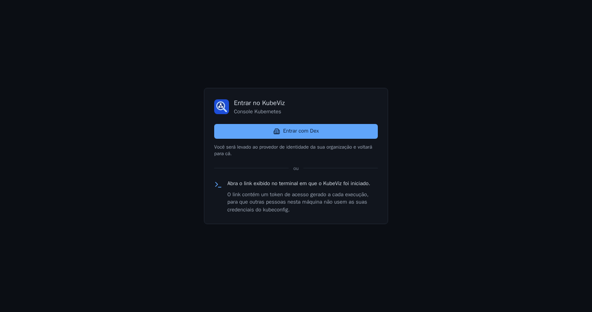

# Login corporativo (OIDC)

O KubeViz aceita login por qualquer provedor OpenID Connect. Keycloak e Dex são
testados oficialmente; Entra ID, Google e Okta devem funcionar, mas ainda sem
teste automatizado. O login por token do Kubernetes continua disponível como
alternativa.



## Como funciona

1. A pessoa clica em **Entrar com …** e vai para o provedor (fluxo de código
   de autorização com PKCE, `state` e `nonce`).
2. Na volta, o KubeViz valida o ID token: assinatura, emissor, audiência,
   validade e nonce.
3. O KubeViz pergunta ao cluster quem a sessão é (`SelfSubjectReview`). Se o
   cluster recusar, o login falha com uma mensagem que diz o motivo.
4. Os tokens ficam só no servidor. O navegador recebe apenas o cookie de
   sessão.
5. O login é renovado no provedor pelo refresh token quando o ID token está
   perto de vencer. Se a renovação falhar (pessoa desativada, sessão encerrada
   no provedor), a sessão do KubeViz acaba. Sem refresh token, a sessão dura o
   mesmo que o ID token.

## Os dois modos

| | `impersonate` (padrão) | `token` |
|---|---|---|
| Como a identidade chega ao cluster | O KubeViz usa a própria credencial com os cabeçalhos `Impersonate-User` e `Impersonate-Group` | O ID token da pessoa é repassado à API |
| Configurar o API server | Não precisa | Precisa confiar no provedor (`--oidc-issuer-url` ou `AuthenticationConfiguration`); impossível em alguns clusters gerenciados |
| Permissão do KubeViz | `impersonate` em `users` e `groups` (o chart cria) | Nenhuma |
| Nomes no RBAC | Com os prefixos do KubeViz: `oidc:ana@empresa.com`, `oidc:dev` | Os que o API server define |

**Segurança no modo impersonate:**

- Os prefixos (`oidc:` por padrão) impedem que alguém do provedor se passe por
  um usuário ou grupo do cluster.
- Usuários e grupos `system:*` são sempre recusados.
- Se o nome do usuário vem do e-mail, o e-mail precisa estar verificado.
- Cabeçalhos `Impersonate-*` enviados pelo navegador são descartados.
- A permissão `impersonate` é a única que a ServiceAccount do KubeViz recebe.

## Configuração (Helm)

1. Registre no provedor um cliente confidencial com o endereço de retorno
   `https://<seu-kubeviz>/auth/oidc/callback`.
2. Guarde o client secret num Secret:

   ```bash
   kubectl -n kubeviz create secret generic kubeviz-oidc --from-literal=client-secret='<segredo>'
   ```

3. Instale ou atualize o chart:

```yaml
oidc:
  enabled: true
  issuerURL: https://keycloak.empresa.com/realms/empresa
  clientID: kubeviz
  clientSecret:
    existingSecret: kubeviz-oidc
  redirectURL: https://kubeviz.empresa.com/auth/oidc/callback
  displayName: Keycloak
  # Dex: [openid, profile, email, groups, offline_access]
  scopes: [openid, profile, email]
```

4. Dê permissões com os nomes prefixados:

```yaml
apiVersion: rbac.authorization.k8s.io/v1
kind: RoleBinding
metadata: { name: dev-edit, namespace: app }
roleRef: { apiGroup: rbac.authorization.k8s.io, kind: ClusterRole, name: edit }
subjects:
  - { apiGroup: rbac.authorization.k8s.io, kind: Group, name: "oidc:dev" }
```

**Dicas por provedor:**

- **Keycloak:**
  - para enviar os grupos, crie no cliente um mapper *Group Membership*, com o
    claim `groups` e sem o caminho completo;
  - o Keycloak recusa escopos que não conhece, então não peça `groups`.
- **Dex:**
  - peça `groups` para receber os grupos;
  - peça `offline_access` para receber o refresh token.

As demais opções estão em
[values.yaml](../deploy/helm/kubeviz/values.yaml):

- o campo do nome do usuário e o dos grupos;
- os prefixos;
- a CA do provedor (`caConfigMap`).

Fora do Helm, as mesmas opções existem como flags `--oidc-*` e variáveis de
ambiente `KUBEVIZ_OIDC_*`. O client secret só é aceito pela variável de
ambiente ou por arquivo (`--oidc-client-secret-file`), nunca como flag, porque
as flags aparecem na lista de processos.

## Por que o login falhou

A tela de login explica o motivo. Os mais comuns:

| Mensagem | Causa |
|---|---|
| O KubeViz não tem permissão para agir em nome dos usuários | Modo impersonate sem a permissão `impersonate` (instalação fora do chart?) |
| O cluster não aceitou o seu login | Modo token com um API server que não confia no provedor |
| O provedor não informou um usuário válido | E-mail não verificado, ou o campo configurado em `usernameClaim` não existe |
| O login expirou ou foi iniciado em outra aba | O retorno do provedor demorou mais de 10 min ou veio de outro navegador |

O log do KubeViz registra o detalhe de cada falha e cada login
(`login OIDC usuario=… grupos=…`).

## Testar localmente

Os scripts sobem provedores de teste em containers e aplicam as permissões no
cluster kind de desenvolvimento (`make demo`). As senhas são aleatórias e ficam
em `~/.config/kubeviz/oidc-demo`.

```bash
hack/oidc/dex.sh        # Dex: usuária ana (leitura em demo) e um login com grupos (edição em demo)
hack/oidc/keycloak.sh   # Keycloak: usuária bia no grupo dev; tokens de 2 min (exercita a renovação)
```

Cada script imprime a linha de comando do KubeViz. Para remover os containers:
`hack/oidc/dex.sh down` ou `hack/oidc/keycloak.sh down`.
